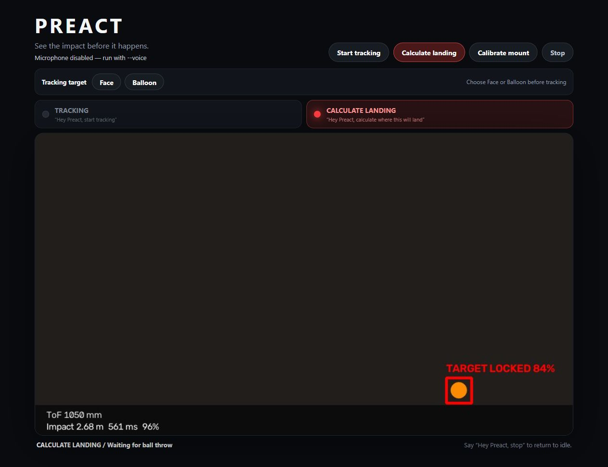
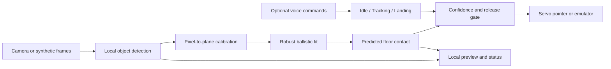

# PREACT

**Track a moving object. Predict where it will land. Point before impact.**

PREACT is a camera-based robotics prototype built by **Philip, Michelle, and
Malte** for the **Axiometa × Anthropic Hardware Hack**, London, 17–19 July 2026.
It combines local computer vision, a physics-based trajectory estimator, and a
microcontroller-driven pointer in a voice-controlled demo.

The core demonstration uses a thrown ball in a calibrated vertical plane.
Separate tracking modes follow a coloured balloon or an explicitly configured
face reference. A complete synthetic demo runs without a camera, microphone,
hardware, or API credentials.



*Generated camera preview with emulated hardware; this is not a physical trial.*

## Try it

Use **Python 3.12**. Run these commands from the repository root:

```bash
python -m venv .venv
```

Activate the environment:

```powershell
# Windows PowerShell
.venv\Scripts\Activate.ps1
```

```bash
# macOS / Linux
source .venv/bin/activate
```

Then install and start:

```bash
python -m pip install -e ".[dev]"
python -m preact
```

Open **[localhost:8765](http://127.0.0.1:8765)**. Choose **Calculate landing** to
run a repeating synthetic throw, or select **Balloon**, then **Start tracking**
to follow the simulated object. **Stop** clears the track and returns the
emulated pointer to neutral. The preview is generated locally.

First installation needs internet access to download dependencies. The default
demo itself makes no model API calls and opens no physical devices.

## What is implemented

| Component | Implementation |
| --- | --- |
| Perception | OpenCV colour segmentation, motion/background filtering, target association, and optional local face tracking |
| Calibration | ArUco markers or measured image corners map a side-on camera view into metres |
| Prediction | Robust fixed-gravity trajectory fitting, future floor intersection, and a confidence gate |
| Actuation | Planar pointer with JSON serial commands, or a separate two-axis pan/tilt controller with text commands |
| Interaction | FastAPI UI, MJPEG preview, explicit idle/tracking/landing states, and local Stop |
| Voice | Opt-in local Whisper transcription; exact commands parsed locally; optional Claude classification of paraphrases |
| Reproducibility | Synthetic camera/ToF input, video replay, JSONL telemetry, tests, and seeded trajectory validation |

## How it works



Tracking follows the current target. Landing mode collects observations of a
new throw and predicts its first floor contact. With the JSON firmware, a
Time-of-Flight passage sensor gates the throw. Replay and camera-only bench
modes use explicit alternatives to that physical gate.

The trajectory estimator and servo loop run locally. Claude is optional and is
used for command interpretation or one-shot object selection, outside the
per-frame prediction loop. See [Architecture](docs/ARCHITECTURE.md) and
[Math](docs/MATH.md) for the implementation details.

## Validation and limits

On **16 October 2026**, the seeded trajectory check produced:

| Metric | Synthetic result |
| --- | ---: |
| Scenarios | 300 |
| Accepted predictions within 20 cm | 297 / 300 (99%) |
| Median landing error, accepted predictions | 1.55 cm |
| 95th-percentile landing error, accepted predictions | 5.16 cm |

These are **simulated coordinate observations with noise and occasional
outliers**, not camera or hardware accuracy measurements. Three scenarios
were withheld by the confidence threshold. The validation does not measure
image detection, physical calibration, servo error, or end-to-end latency.
See [Validation](docs/VALIDATION.md) for the command, thresholds, and test scope.

This is a hackathon prototype. The landing model assumes approximately
ballistic motion in one calibrated plane; it does not recover arbitrary 3D
motion or demonstrate drone detection. Pan/tilt tracking is a separate control
path and does not turn the landing model into a 3D estimator. Physical accuracy
and repeatability still need a measured hardware evaluation.

## Camera, hardware, and voice

The [Setup guide](docs/SETUP.md) covers calibration, camera-only development,
deterministic video replay, and both firmware variants. Existing `config/`
files are examples from the hackathon setup; recalibrate for your camera and
mount.

Voice is opt-in with `--voice`. Copy `.env.example` to `.env` only if you need
optional cloud features. Exact commands such as “Hey Preact, stop” do not need
an API key, but the local Whisper model must be available. Personal reference
images, face profiles, model weights, and recordings are not distributed.

## Development

```bash
python -m pytest -q
python -m ruff check src tests
python -m preact.trajectory_validation --scenarios 300
```

[Development](docs/DEVELOPMENT.md) explains verification, packaging, and the
repository layout. [Validation](docs/VALIDATION.md) distinguishes automated
checks from hardware testing.

## Explore the repository

- [Architecture](docs/ARCHITECTURE.md): runtime, data flow, and hardware interfaces.
- [Math](docs/MATH.md): trajectory fitting, confidence, and coordinate transforms.
- [Setup](docs/SETUP.md): reproducible commands for each operating mode.
- [Hardware](docs/HARDWARE.md) and [serial protocol](docs/PROTOCOL.md): the JSON ToF/LED/pointer build.
- [Project scope](docs/POSITIONING.md): demonstrated capabilities and open questions.
- [Hackathon notes](docs/HACKATHON_PLAN.md) and [decisions](docs/DECISIONS.md): development history.

Built as a team project. Commit history records repository contributions;
this README does not assign individual ownership of each subsystem.
