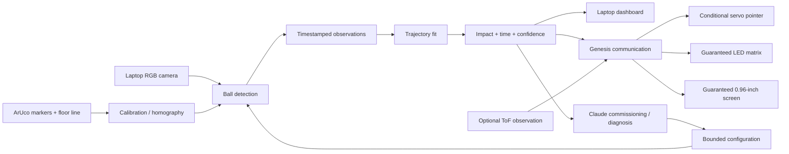

# Architecture

## System flow



## Camera pipeline

1. Capture 720p frames and monotonic timestamps.
2. Restrict processing to the calibrated throwing region.
3. Convert to HSV and segment a matte, high-saturation ball.
4. Filter contours by size, circularity, and continuity.
5. Convert centroid pixels to centimetres in the throwing plane.
6. Record every observation, rejection reason, and frame timestamp.

## Trajectory model

For the controlled MVP:

- Horizontal position is approximately linear over time.
- Vertical position is fitted with a quadratic curve.
- The first future intersection with the calibrated floor line is the predicted landing point.
- Confidence incorporates observation count, fit residual, extrapolation time, and recent detection continuity.

Prediction message:

```json
{
  "valid": true,
  "target_cm": 142.5,
  "time_to_impact_ms": 640,
  "confidence": 0.86
}
```

## Genesis output

Implement the guaranteed LED/screen output first.

- Green: high-confidence prediction.
- Yellow: tentative prediction.
- Red or blank: invalid prediction.
- Screen: target centimetres or left/centre/right, time to impact, confidence.
- Servo: only enabled when the adapter, servo, and approved external power are confirmed.

## Claude integration

Claude receives:

- one commissioning image,
- human intent such as “track the orange foam ball,”
- bounded configuration schema,
- post-throw summary statistics.

Claude may suggest colour thresholds, region of interest, or one bounded parameter change. It must not calculate the precise landing coordinate or issue time-critical actuator commands.

## Replay mode

All camera input can be replaced with a recorded video. Replay mode must:

- reproduce detections and predictions,
- drive the same UI,
- optionally emulate Genesis output,
- provide a reliable backup for judging.
