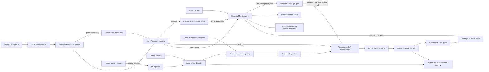

# Architecture

## Current proof vs. venue build

The checked-in runtime proves perception and landing prediction in a calibrated
side-on camera plane and maps that result to a single planar pointer angle. The
venue target is a two-servo pan/tilt pointer plus a ToF passage/range sensor.
That mechanical 3D layer still requires hardware pin-map, pan/tilt geometry,
and range calibration at the venue. A single fixed ToF sensor is useful for
release detection and a distance sample; it does not by itself reconstruct an
unconstrained 3D flight path.

## End-to-end flow

## Operating modes

`PREACTRuntime` owns one explicit state:

- `idle`: a clean camera preview remains available, but detection and trajectory
  processing are paused, the servo is neutral, both indicators are off, and
  voice remains ready;
- `tracking`: every accepted ball detection becomes a current-position servo
  target, without requiring a ToF trigger;
- `landing`: ToF gates a fresh observation sequence, then the ballistic fit
  produces a future floor target.

Every mode transition resets old observations and sends a mode command to
Genesis. Stop is a deterministic local transition and never depends on Claude
or network availability.

## Coordinate system

The camera is side-on to a marked throwing plane:

- `x = 0` at the left edge of the landing strip;
- positive `x` runs along the floor;
- `y = 0` is the calibrated floor;
- positive `y` points upward;
- all physical coordinates are metres.

Four ArUco marker centres or four manually measured image points define a
homography. The camera resolution used for calibration must match the live
resolution.

## ToF role

The single-zone ToF module does not reconstruct a trajectory. It is aimed at a
static background near the release line:

1. collect at least ten valid background distances;
2. use their median as the baseline;
3. trigger when the distance falls by at least 80 mm;
4. clear the previous camera track;
5. allow prediction and servo output for a three-second window;
6. re-arm after the range returns within 35 mm of baseline.

The thresholds are configurable at runtime and in `ToFGateConfig`.

## Camera pipeline

1. Capture at a requested 1280 × 720, 30 FPS with monotonic timestamps.
2. Apply one or two OpenCV HSV ranges. Two ranges handle hue wraparound at red.
3. Morphologically open and close the mask.
4. Filter contours by area, circularity, rotated aspect ratio, rectangularity,
   mean saturation/value, and optional dominant BGR-channel separation.
5. Require a new target to remain consistent for a configurable number of
   frames, then associate later candidates with the locked position. A missing
   target produces no detection instead of jumping to a distant distractor.
6. Draw a tight red box around the accepted contour in the local MJPEG view.
7. Convert the centroid to metres.
8. Retain at most 40 recent observations.

## Tracking, prediction, and actuation

In tracking mode, the detector centroid is converted to world \((x,y)\). The
one-axis arm points at that coordinate using the calibrated servo-axis position
in the same vertical plane. A low-quality detection is ignored, and loss of the
ball for 350 ms returns the pointer to neutral.

The predictor fits horizontal constant velocity and vertical ballistic motion
with fixed gravity. Huber-weighted iterative least squares suppresses isolated
detection errors. It then solves the positive future root where `y = 0`.

The servo planner rejects output unless:

- the ToF trigger is recent;
- the fit is valid;
- impact is 40 ms to 3 s in the future;
- speeds remain inside the demo envelope;
- confidence is at least 0.45 by default.

With `planar-pointing`, both current and future points use the bearing from the
servo axis to the target. `linear` remains available for a compact printed
landing scale. Both laptop and firmware clamp angles.

## Claude boundary

With `--voice`, faster-whisper transcribes locally. Canonical commands are
parsed locally. Only a wake-phrase utterance that is not an exact canonical
command is sent as text to Claude Sonnet 5, which must call a strict tool with
one of `tracking`, `landing`, `stop`, or `ignore`.

With explicit `--claude-target-lock`, Claude receives one JPEG and a separate
strict tool schema. It may return only a bounding box for one safe, inanimate,
bright demo object. Local code validates the box and derives exact HSV bounds
from its pixels.

Claude never receives ToF control authority, computes the landing coordinate,
or writes a servo command. Stop and the time-critical control loop remain local.
A saved local detector profile is the offline vision path.

## Processes and interfaces

- `PREACTRuntime`: one worker thread that owns capture and inference.
- `MicrophoneVoiceService`: opt-in local audio capture and utterance segmentation.
- `ClaudeVoiceInterpreter`: exact local parser plus strict Claude fallback.
- FastAPI: local mode, Stop, status, and MJPEG endpoints.
- `GenesisSerial`: non-blocking serial polling and newline JSON writes.
- `GenesisEmulator`: deterministic synthetic/replay actuator.
- `SessionLogger`: JSONL telemetry for tuning and evidence.
- `OpenCVFrameSource`: explicit camera or recorded video.
- `ScriptedToFFrameSource`: deterministic ToF pulse for file replay only.

The safe default is `SyntheticFrameSource`; constructing it cannot access a
physical camera.
